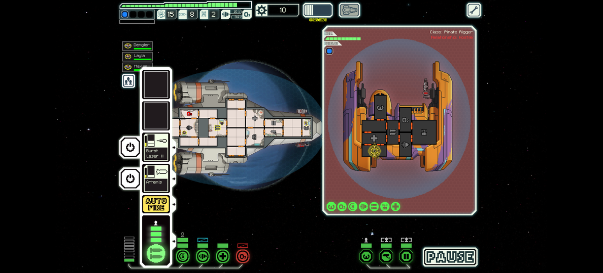
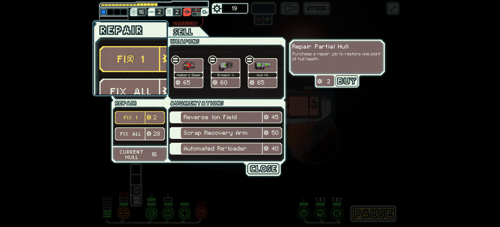
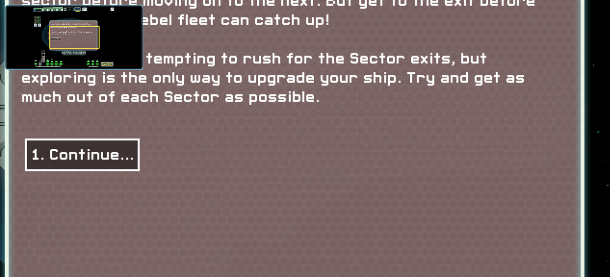

# ftl-android

Play the iPad version of FTL: Faster Than Light on an Android phone. This runs
the real iOS game, with touch controls added for small screens.

The app doesn't include the game: you need your own copy of FTL for iPad.

| Hold a finger to magnify small buttons | Pinch to zoom; the minimap shows where you are |
|---|---|
|  |  |

## Install

1. On your phone, download the `.apk` from the
   [latest release](https://github.com/Sidd065/ftl-android/releases/latest)
   and open it. Android will ask you to allow installs from your browser first.
2. Open FTL and pick your copy of the game: the `.ipa`, a zip of `FTL.app`, or
   the extracted folder. Or tap the `.ipa` in your downloads and open it with
   FTL.
3. Pick a language and play.

You need Android 8.0 or newer on a 64-bit phone, about 250 MB of free space,
and FTL for iPad 1.6.21. Copies straight from the App Store are encrypted and
won't work.

To update, install the new `.apk` over the old one. Your saves are kept.

## Controls

| Gesture | What it does |
|---|---|
| Tap | Same as on the iPad |
| Hold | Magnifier: slide onto a small button, then lift |
| Pinch, two-finger drag | Zoom and pan |
| Two-finger tap | Pause and resume |
| Back | Close the window or open the menu |

To open and close doors, tap the door button in the bottom-left corner, then
tap or drag across doors. The beacon map and the upgrade screen zoom in on
their own. A keyboard, mouse or game controller works too; settings lists the
buttons.

## Settings and saves

Long-press the app icon for settings: the magnifier, zoom, text size, vibration
and graphics. That's also where you export and import saves (to keep a backup
or move to another phone), save logs, and manage mods.

## Mods

Mods made for FTL 1.6 on PC work, installed with
[ftlman](https://github.com/afishhh/ftlman) like on a computer. Download a mod
in your phone's browser, tap the file and open it with FTL, then tap **Apply
and restart**.

These were tested in an emulator: each one installs and starts a run.

| Mod | What it does |
|---|---|
| [Captain's Edition](https://subsetgames.com/forum/viewtopic.php?t=15663) | Big overhaul: events, sectors, ships, weapons. Needs its resource pack, listed first |
| [Arsenal+](https://subsetgames.com/forum/viewtopic.php?t=29891) | Big overhaul: factions, sectors, weapons, ships. Base Resources goes first, then Base Data |
| [Stations Job](https://subsetgames.com/forum/viewtopic.php?t=24424) | Play as a space station |
| [The RAD Fleet](https://subsetgames.com/forum/viewtopic.php?t=27381) | Replaces all the player ships |
| [Twinge's Balance & Bugfix](https://subsetgames.com/forum/viewtopic.php?t=26269) | Rebalance and bug fixes |
| [Vicious Vessels](https://subsetgames.com/forum/viewtopic.php?t=32298) | 40 new enemy ships |
| [Railguns, Photocasters & More!](https://subsetgames.com/forum/viewtopic.php?t=30294) | New weapons and drones |
| [The Athena](https://subsetgames.com/forum/viewtopic.php?p=121702) | A ship you kit out yourself at the start |
| [KRS Obsidian Cruiser](https://github.com/zedseven/ftl-obsidian-cruiser) | New ship in place of Engi B |
| [HighRes Backgrounds and Planets](https://subsetgames.com/forum/viewtopic.php?t=30003) | Sharper backgrounds and planets |
| [Detailed Ship Greebles](https://subsetgames.com/forum/viewtopic.php?t=26931) | More detailed hulls |
| [FTL Event Tags](https://github.com/thrnz/FTLEventTags1.6) | Shows where event choices lead |
| [Better info](https://subsetgames.com/forum/viewtopic.php?t=38336) | Exact numbers in tooltips |
| [Extended Pursuit Indicator](https://subsetgames.com/forum/viewtopic.php?t=26289) | Shows the rebel fleet further ahead on the map |

Mods that need Hyperspace, such as Multiverse, work with the Hyperspace build
below.

## Hyperspace (experimental)

Big mods like Multiverse are built on
[Hyperspace](https://github.com/FTL-Hyperspace/FTL-Hyperspace), which changes
the game's code as well as its data. The build from this branch carries it:
get the `.apk` from the
[0.3.2 with Hyperspace](https://github.com/Sidd065/ftl-android/releases/tag/v0.3.2-hyperspace)
pre-release and install it over 0.3.2. Your saves are kept.

1. In settings, turn on **Hyperspace (experimental)**.
2. Add `Hyperspace.ftl` and your mods on the Mods screen. `Hyperspace.ftl` is
   inside any of the
   [Hyperspace 1.23.2](https://github.com/FTL-Hyperspace/FTL-Hyperspace/releases/tag/v1.23.2)
   downloads.
3. Put them in the order below, tick them, then tap **Apply and restart**.

Mods that name their saves, like Multiverse, keep their own run and profile
(unlocks, achievements, scores), so they don't mix with the plain game's. Export
saves in settings takes them along.

These were played on a phone, from the hangar through events, stores and
fights (all the Multiverse addons at once only through the first few events).
Multiverse was also played for several hours on an emulator.
Load orders, top to bottom:

- [Multiverse](https://github.com/FTL-Multiverse-Team/FTL-Multiverse-Releases/releases)
  5.5.1: `Hyperspace.ftl`, Multiverse Assets, Multiverse Data.
- Multiverse addons go after Multiverse Data, in this order (leave out any you
  don't want): Fusion, The Renegade Collection, Forgotten Races (Assets part 1,
  Assets part 2, then Data), The Outer Expansion (Assets, then Data), Darkest
  Desire, Trash Compactor Collection, Forgemaster, Fishier Than Light, and Lily's
  Innovations last. Forgotten Races needs Fusion and The Renegade Collection;
  Forgemaster needs Fusion. The English builds are on
  [ftl-mv-translation](https://github.com/ftl-mv-translation).
- [Arsenal+](https://github.com/ftl-mv-translation/arsenal-plus) 1.36, the
  English build: `Hyperspace.ftl`, Arsenal+.
- [Insurrection+](https://subsetgames.com/forum/viewtopic.php?t=37167):
  `Hyperspace.ftl`, Insurrection+, then its Augmented Weapons and Named Weapons
  modules if you want them. It comes as a `.rar`; take the `.ftl` files out of
  it first.

## Known gaps

- Mods can't get right-clicks or key presses. So Fusion's augment boxes and
  Insurrection+'s enemy evasion display can't be dragged, and mod hotkeys do
  nothing.
- Multiverse's speed controls sit over the JUMP button's label. Both still work
  by touch.

## Problems

- "Still FairPlay-encrypted": that's the App Store copy of the game, which only
  runs on iOS.
- Crashes: in settings, tap **Save logs…** and attach the file to an
  [issue](https://github.com/Sidd065/ftl-android/issues).
- Only tested on Snapdragon phones so far. Game Center is off, so achievements
  stay on the phone.

Building it yourself, and how it works: [docs/development.md](docs/development.md).

FTL: Faster Than Light, including the artwork in the screenshots, is made by
Subset Games. This project isn't affiliated with or endorsed by them.
